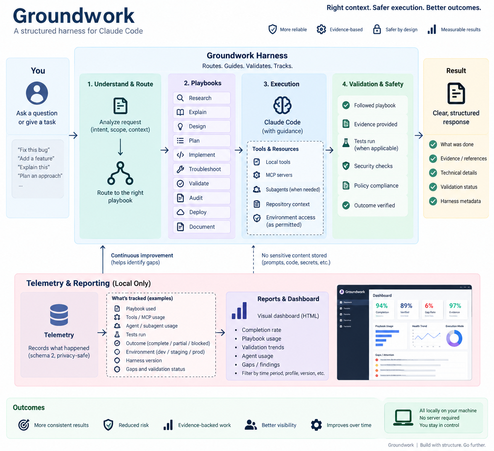
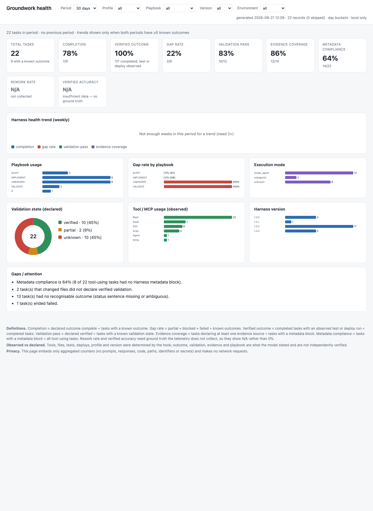

# Groundwork

A small, evidence-first engineering harness on top of [ECC](https://github.com/affaan-m/ECC) and [OpenSpec](https://github.com/Fission-AI/OpenSpec) for Claude Code.

Groundwork is not a fork or a redistribution of ECC or OpenSpec. It installs both from their own official sources and adds a thin governance layer on top. The layer has two parts. The first is five rule files. They route work by risk tier, guide architecture quality, and stop completion claims from outrunning proof. The second is five small deterministic hooks: a push guard; an enforced independent review for material changes; a session-start snapshot of the repository, so a fresh session can continue an existing project; a usage-telemetry recorder; and task tracking, which keeps engineering tasks across sessions and shows Claude Code's permission prompt before sensitive actions. That's the whole product: rule files, hooks, an installer and a small `groundwork` command. It has no new agents, no new skills, no plugin ecosystem, no daemon and no database.

Built and validated by Ashmin ([@AshminPy](https://github.com/AshminPy)). See [CREDITS.md](CREDITS.md) for exactly what is original here and what is installed from upstream.

## Version history

Unreleased (on `main`) adds task tracking around native OpenSpec, as a controlled pilot. Engineering tasks are recorded automatically, kept across sessions, and completed only on evidence. OpenSpec stays the workflow. Sensitive actions show Claude Code's normal permission prompt. These actions are cloud, cluster and Terraform changes, destructive Git, credential access, recursive deletes outside the working directory, and settings and hook edits. See [Task tracking](#task-tracking), [docs/TASK-LIFECYCLE.md](docs/TASK-LIFECYCLE.md) and [CHANGELOG.md](CHANGELOG.md).

Groundwork 2.4 (current) added four capabilities. None of them changes existing behaviour unless used. The first is per-tool-call usage telemetry, a minimal local record of which tools ran and whether each call succeeded. The second is statusLine symbol presets (`symbol_set` and `separator`). The default output is unchanged. The third is a session-start snapshot that names sibling git worktrees holding work that exists only on this machine. The fourth is `groundwork copilot explain`. It gives read-only help with the output of the tmux pane it is typed in, or of piped text. Secret-shaped text is redacted before anything is sent. See [docs/RELEASE-REPORT-2.4.md](docs/RELEASE-REPORT-2.4.md), [docs/MACOS-SMOKE-TEST.md](docs/MACOS-SMOKE-TEST.md) and [CHANGELOG.md](CHANGELOG.md).

Groundwork 2.3 added the `groundwork` CLI (`--help`/`version`/`doctor`/
`integrations`/`update`/`rollback`/`routines`). It is a single, discoverable command that dispatches to Groundwork's existing functionality and reimplements none of it. It also added self-update and rollback to a real published release, and refinements to Routines readiness and quiet interaction. See [docs/RELEASE-REPORT-2.3.md](docs/RELEASE-REPORT-2.3.md) and [CHANGELOG.md](CHANGELOG.md) for full detail.

Groundwork 2.2 added the Integration Catalog and statusLine. The Integration Catalog is a structured, code-defined catalog of external-system integrations. It gives independent, truthful `available`/`configured`/`connected`/`used` observations. statusLine is a Claude Code `statusLine` command that renders Groundwork-specific state. It works under a strict, enforced LIVE / LAST-COMPLETED-TURN / CACHED / UNAVAILABLE data-source contract. See [docs/RELEASE-REPORT-2.2.md](docs/RELEASE-REPORT-2.2.md) and [CHANGELOG.md](CHANGELOG.md) for full detail.

Groundwork 2.1 added context engineering, capability resolution, scheduled Routines, a setup-time capability configurator, and ECC version pinning. It kept the same small-footprint model described below. See [Capabilities, profiles and Routines](#capabilities-profiles-and-routines) and [CHANGELOG.md](CHANGELOG.md) for full detail.

Groundwork 2.0 (what shipped) moved from a lightweight engineering harness to a more complete evidence-first SRE/CloudOps workflow. It kept the same small-footprint model: rule text and composition first, new files only when nothing existing can satisfy the requirement. Full detail, live-validation evidence and exact test/task status are in [CHANGELOG.md](CHANGELOG.md) and [docs/RELEASE-REPORT-2.0.md](docs/RELEASE-REPORT-2.0.md).

- Repository-aware engineering: before proposing infrastructure, platform or delivery work, Groundwork inspects the existing module/pipeline structure, naming and label conventions, environment organization, IAM/networking and state/backend patterns, CI/CD conventions, and the closest existing analogous implementation. It follows them unless they're demonstrably unsafe or broken.
- Dynamic engineering roles: Groundwork automatically reasons from an Infrastructure, Platform, Delivery, or Application Engineer perspective when the task calls for it. The role is a rule-text persona selected per task. It is never a permanent agent file, so there's no agent sprawl to maintain.
- Stronger evidence model: `CONFLICTING EVIDENCE` and `UNKNOWN` were added to the evidence labels (see "Why this exists" below).
- Stronger independent review: a MATERIAL change with a MUST FIX finding now needs three steps before it can be called complete. Fix it, re-run the affected validation, then get a **fresh** independent re-review confirming the finding is resolved. An edit and a test run are not enough.
- Investigation continuity: for work not tracked by an OpenSpec change, a small, capped per-repository file survives context compaction and fresh sessions. It holds the objective, proven facts, evidence, decisions, active/rejected hypotheses with reasons, files changed, validation results, blockers, and next action. It never holds chain-of-thought. Current repository/runtime evidence always outranks what was saved. Rejected hypotheses stay rejected. One is reopened only when new evidence actually contradicts the original reason, and that evidence must be stated. They are not silently re-proposed as still open.
- SRE/CloudOps workflow composition: troubleshooting, RCA, deployment, validation, audit, and documentation compose the existing playbooks, curated ECC agents/skills, repository-understanding, and MCP/CLI tool access. This shipped zero new agent or skill files.
- Clearer execution boundaries: read-only discovery stays always allowed. Nonprod mutation explicitly authorized by the task proceeds under existing permissions. Production, IAM, data-destructive, or paid-resource changes require explicit authorization, separate from a merely reversible file edit. (A further tier of deterministic, naming-pattern-based guards for production/IAM operations was designed but deliberately not built. Heuristic production detection by name risks false confidence. See [docs/FUTURE-SCOPE.md](docs/FUTURE-SCOPE.md).)
- Completion truth extended to builder work: the existing Code / Tests / Reviewed / Merged / Deployed / Live-validated facts now explicitly cover infrastructure/platform/delivery work too. The loop is closed: a failed runtime validation routes to root-cause analysis, a fix, and a re-validation before any completion claim.
- Presentation support: technical work can be turned into a Markdown/Mermaid presentation by default (portable, no plan/tool gate). It can instead be handed to an installed document-generation plugin for a bundled `.pptx`/`.docx`, when the user wants one and the plugin is actually present. The underlying technical truth is the same however it's presented. A native Claude Code output style may change tone, never that truth.
- Teach/Learn mode: Groundwork can explain what was fixed, why it failed, and what evidence proved it. It uses only the evidence that session (or a recoverable investigation file) actually established. When that evidence trail isn't available, it says so plainly. It does not invent a plausible-sounding story.

## Why this exists

ECC ships dozens of agents and hundreds of skills. Run `claude plugin details ecc@ecc` for the exact count. ECC has been installed pinned to a tested ref since Groundwork 2.1, so the number only moves when Groundwork itself re-pins it. See [ARCHITECTURE.md](docs/ARCHITECTURE.md). These agents and skills are excellent once invoked, but nothing invokes them on its own. Left alone, a plain request to "add X" gets implemented without a plan, without tests, and without review. The final report says it's done regardless. OpenSpec gives you a real spec-driven change lifecycle, but only when you run `/opsx:*`. Even then, nothing stops an agent from claiming a change is complete with a failing test still in the suite. Neither tool tells Claude *what a good design is*, *when to delegate*, or *how to pick a project back up next week*.

Groundwork closes exactly those gaps, and nothing else:

1. Route by risk, not by ceremony. A one-line fix shouldn't get a spec. A production-facing change should. `rules/engineering-workflow.md` defines three tiers and what each one requires.
2. Design for the change you can see, not the one you imagine. `rules/architecture-quality.md` gives the governing principle: the smallest design that satisfies today's requirement while keeping low-cost paths for foreseeable change. It also gives the questions to answer before material work, and the rule for variation points. Environments, providers, clusters, models, regions and tenants belong behind configuration, not hard-coded.
3. Evidence beats intuition, always. Every material technical decision cites a real source. Every completion claim shows the command and the result. Validation climbs a ladder derived from the project's own tooling and ends at the real runtime when runtime matters. `rules/evidence-policy.md` sets the rules and the labels (VERIFIED / UNVERIFIED / ASSUMPTION / INFERENCE / CONFLICTING EVIDENCE / UNKNOWN / RUNTIME VALIDATION REQUIRED).
4. Delegation is Claude's decision, not the user's. The workflow rule says when to stay in the main session, when to use a subagent, and when Claude Code's native Agent Teams are justified. You never have to say "create four agents".
5. Independent review is enforced, not requested. `hooks/require_material_review.py` is a Stop hook. It will not let a session end if a spec-driven change is fully implemented and nothing that looks like a reviewer ever ran against it. A reviewer can be an ECC reviewer, a subagent, or an Agent Team reviewer teammate. See [docs/VALIDATION.md](docs/VALIDATION.md).
6. Continuation comes from the repository. `hooks/groundwork_session_snapshot.py` injects a deterministic snapshot at every session start. The snapshot holds the branch, dirty files, OpenSpec task progress, and the verification commands the repo declares. The workflow rule tells Claude how to rebuild a DONE / PARTIAL / MISSING / BLOCKED / UNVERIFIED picture from git, OpenSpec, docs, tests and code before touching anything.

## Architecture at a glance



How to read it against the implementation:

- Understand & route, Playbooks, and Result are rules the model follows (`rules/task-routing.md`, `playbooks/`, `rules/output-contract.md`). They are guidance, not enforcement.
- Validation & safety mixes the two. The protected-branch push guard, the material-change review gate and `permissions.deny` are hooks and settings that run deterministically. "Evidence provided", "tests run" and "followed playbook" are rule-driven expectations. "Outcome verified" means the outcome the model declared is recorded and, where possible, corroborated by an observed test or deploy run. The harness does not independently prove task correctness.
- Telemetry & reporting is deterministic. The Stop hook records observed facts (tools, files, tests, agent calls, version, profile) and declared metadata (playbook, outcome, validation, evidence). The report generator turns them into the local dashboard. The "continuous improvement" arrow is you reading the gaps list. Nothing feeds back into routing automatically.
- The dashboard numbers in the picture are illustrative. The real dashboard is generated from your own telemetry (see "Health dashboard" below).

## Architecture

```
                    USER GOAL
                        │   ← session-start snapshot (git · OpenSpec · commands) injected first
                        ▼
   rules/engineering-workflow.md  ──  classifies TRIVIAL / STANDARD / MATERIAL,
                        │             picks main session / subagents / Agent Team
        ┌───────────────┴───────────────┐
        ▼                                ▼
     OpenSpec                          ECC
  WHAT / WHY / acceptance        HOW: agents, skills,
  criteria as scenarios          GateGuard, session
  (per-repo, file-based)         persistence, learning
        │                                │
        └───────────────┬───────────────┘
                         ▼
   rules/architecture-quality.md — smallest design, variation
        points as config, no abstraction without a reason
                         ▼
         rules/evidence-policy.md — decisions cited, validation
          ladder to the real runtime, claims proven, labels honest
                         ▼
       hooks/require_material_review.py — Stop hook,
         blocks completion without independent review
                         ▼
              COMPLETION STATUS block
   Code / Tests / Reviewed / Merged / Deployed / Live validated
      → COMPLETE / PARTIAL / BLOCKED / PLANNED / FAILED
```

Full detail: [docs/ARCHITECTURE.md](docs/ARCHITECTURE.md).

## Quick start

Requirements: Claude Code ≥ 2.1, Node ≥ 20.19.0, npm, Python 3.10+, git. OpenSpec's own CLI requirement sets the Node floor, verified against its `engines.node` field. ECC itself only needs Node ≥18.

```bash
git clone https://github.com/AshminPy/groundwork.git
cd groundwork
./setup.sh
```

`setup.sh` is a thin wrapper around the tested installer. It checks the prerequisites and offers to install any that are missing (see below). It backs up your complete `~/.claude` directory to `~/.claude-backups/groundwork-YYYYMMDD-HHMMSS/`. The backup is owner-only, previous backups are never overwritten, and a missing `~/.claude` is fine. Then it asks three questions, runs `install.sh`, applies the reporting schedule, verifies the installation, generates the first dashboard and prints a summary. Backups stay local and are never transmitted. They can contain settings, MCP configuration, rules and hooks, so treat them as sensitive.

Claude Code itself must already be installed and signed in. It is the product being configured, so the script stops with the official install link otherwise. The other prerequisites are detected per operating system: git, Node 20.19+ with npm, and Python 3.10+. Anything missing is listed with the exact official command. It is installed only after you answer **y** (or pass `--install-prereqs`; `--no-install-prereqs` never installs):

| OS | Package manager | Commands used |
|---|---|---|
| macOS | Homebrew (`brew`) | `brew install git` · `brew install node` · `brew install python@3.12` |
| Debian / Ubuntu | apt | `sudo apt-get install -y git` · `sudo apt-get install -y nodejs npm` · `sudo apt-get install -y python3` |
| Fedora / RHEL | dnf | `sudo dnf install -y git` · `sudo dnf install -y nodejs npm` · `sudo dnf install -y python3` |
| Alpine | apk | `sudo apk add git` · `sudo apk add nodejs npm` · `sudo apk add python3` |

Deliberate limits: Homebrew itself is not installed for you. Its official one-liner is printed instead, because it needs your password. A Node.js that exists but is older than 20.19.0 is left to your version manager (nvm, asdf, volta), with a clear message. `--non-interactive` never installs anything unless `--install-prereqs` is given. After installing, the check runs again.

The three required questions, plus one optional fourth:

- Profile: Work / Personal / Other. Sets `GROUNDWORK_PROFILE` in your `settings.json` `env`. This is machine-specific, recorded by telemetry and shown on the dashboard. Nothing in the repo hard-codes it.
- Agent Teams: No (recommended) / Yes. Yes runs `./install.sh --agent-teams`.
- Dashboard schedule: Weekly (recommended) / Daily / Monthly / Yearly / Disabled, applied through the existing report scheduler.
- Capabilities and Routines (optional, defaults to skip): pick a profile (SRE/CloudOps, Platform Engineering, DevOps, Software Engineering, Cloud Architecture, Security Engineering, Minimal, Custom) to enable cloud/platform/integration awareness, optional skills, and scheduled Routines like a Jira end-of-day update or a daily news digest. See [Capabilities, profiles and Routines](#capabilities-profiles-and-routines) below.

Other modes:

```bash
./setup.sh --verify       # read-only: version, rules, playbooks, hooks, ECC, OpenSpec, telemetry, dashboard, schedule → PASS / FAIL / NOT CONFIGURED
./setup.sh --doctor       # read-only: everything --verify checks, plus configured capabilities and every Routine's status
./setup.sh --configure    # revisit capability/Routine selection only — no backup, no reinstall
./setup.sh --routines     # list configured Routines and their last-run status
./setup.sh --rollback     # restore the latest setup.sh backup; the current ~/.claude is moved to ~/.claude-groundwork-disabled-<timestamp>/ first, never deleted
./setup.sh --rollback ~/.claude-backups/groundwork-20260921-144500   # a specific backup (required when timestamps are ambiguous)
./setup.sh --uninstall    # delegates to uninstall.sh: removes Groundwork, keeps telemetry and reports
./setup.sh --non-interactive --profile work --no-agent-teams --schedule weekly   # scripted setup
./setup.sh --non-interactive --profile work --capability-profile sre-cloudops    # scripted setup with a capability profile
```

If setup fails after the backup was taken, it prints the failure, the backup path and the rollback command. Your previous configuration is never deleted.

### The `groundwork` command

After `./setup.sh` (or `./install.sh`) finishes, the `groundwork` command is on your `PATH`. Open a new terminal, or run the `source` command install prints if you want it in your current one. It is the primary discoverable interface. It is a single entry point that dispatches to the same functionality documented above. It does not replace that functionality.

```bash
groundwork --help                    # lists what's implemented
groundwork version                   # the installed Groundwork version
groundwork doctor                    # identical to ./setup.sh --doctor, callable from anywhere
groundwork integrations list         # the Integration Catalog: one line per integration
groundwork integrations show NAME    # full detail for one integration
groundwork integrations doctor NAME  # show's detail plus a reason for each observation
groundwork integrations refresh      # re-run every probe and persist to the statusLine's cache
groundwork update --check            # non-mutating: current vs. latest published release
groundwork update                    # installs the latest published, stable release
groundwork update --version 2.3.0    # installs that exact published release
groundwork rollback                  # restores the most recent backup (same as ./setup.sh --rollback)
groundwork rollback --version 2.2.0  # restores the backup taken right before 2.2.0 was installed
groundwork routines list             # every routine: enabled/mutates/schedule/readiness/last-run
groundwork routines run pr_followup  # run one routine now (same fail-closed path scheduling uses)
groundwork routines doctor           # readiness detail for every routine
groundwork routines doctor jira_eod  # readiness detail for just one routine
groundwork routines schedule news daily --hour 8 --minute 0   # change a routine's schedule
groundwork statusline config list    # every statusLine display setting and its current value
groundwork usage --window 5h         # which sessions used the plan most (also: --window 7d)
groundwork statusline config set show_cost true   # change one setting (`config unset KEY` reverts it)
groundwork task list                 # open tasks in this repository (--all: every repository)
groundwork task show COR-123         # one task: phase, progress, verification, review, history
groundwork task complete COR-123     # complete a task (MATERIAL: only on evidence)

groundwork copilot explain           # read-only: what went wrong in THIS terminal (tmux), and what to check next
groundwork copilot explain --dry-run # show exactly what would be sent; send nothing
some_cmd 2>&1 | groundwork copilot explain --stdin   # any terminal: explain the output you pipe in
```

Everything documented in this README as a direct script or `setup.sh` flag invocation keeps
working exactly as before. `groundwork` is an additional, smaller-surface way to reach a subset
of it. It is not the only way. `groundwork integrations` forwards its arguments verbatim to
`groundwork_integrations.py`. See [docs/INTEGRATIONS.md](docs/INTEGRATIONS.md) for the full truth
model. `groundwork update`/`rollback` never reimplement the installer. See
[docs/UPGRADE-ROLLBACK.md](docs/UPGRADE-ROLLBACK.md) for the full behavior. `groundwork routines`
forwards to the existing Routines execution/scheduling engine unchanged. See
[docs/ROUTINES.md](docs/ROUTINES.md) for the full truth model and the six shipped routines.
`groundwork statusline config` views and changes the statusLine's display settings (mode, symbols, separator, which items show).
`groundwork task` forwards to the task ledger. See [Task tracking](#task-tracking).

`groundwork copilot explain` is **read-only** help with a failure in the terminal you typed it in. In a tmux pane it reads a bounded slice of that pane's recent output (default 120 lines, at most 400 lines / 16,000 characters). It proves the pane is yours with three checks: `$TMUX_PANE`, your process's own controlling tty, and the pane's process being an ancestor of yours. There is no option to read another pane, and a spoofed pane id is refused. It removes control, bidi and zero-width characters. It redacts secret-shaped text, in the output and in the git facts it adds, before cutting to the window. Then it makes one `claude -p --safe-mode --tools ""` call, with the prompt on stdin and an empty scratch working directory.

Verified on Claude Code 2.1.296: `--tools ""` alone leaves plugin MCP tools in the model's tool list and lets a project's hooks and MCP servers run, while `--safe-mode` removes them, so the model is offered no tools and no project hook or server runs. Admin-managed policy settings still apply. An older `claude` without `--safe-mode` falls back to `--strict-mcp-config --setting-sources user`. There, your own user-level settings still apply.

The terminal output and git facts are fenced as untrusted data, and the answer must quote its evidence. Even so, a hostile output can make the text of an answer wrong or suggest a harmful command. So every answer ends by saying that nothing was run and that a suggestion comes from untrusted output. Use `--dry-run` to see exactly what would be sent.

Limits:

- Retroactive reading works only in tmux. Other terminals pipe the output with `--stdin`. iTerm2 and Terminal.app readers are not built and not validated.
- Run it as its own command. `cmd; groundwork copilot explain` on one line cuts cmd's output.
- It cannot open your files, so it often ends with "UNKNOWN — show me X". The model has no tools. Also, every `@` that could be read as a Claude Code file mention is replaced by a look-alike before the prompt is sent, because Claude Code otherwise attaches a file named as `@path` in the prompt text.
- Redaction is best effort. An unrecognised secret shape survives, and some benign error text mentioning "token" is left alone on purpose.
- It never executes a suggestion. Authorized execution is deliberately not built.

See [openspec/changes/add-groundwork-copilot/](openspec/changes/add-groundwork-copilot/).

Per project, once, if you want spec-driven work there:
```bash
cd your-project
openspec init --tools claude
```

That's it. Start a normal Claude Code session and give it an engineering task. Or open an existing project and say "Continue this project."

### Manual / advanced installation

`install.sh` remains the source of truth. You can run it directly (no backup, no questions):

```bash
./install.sh                 # ECC + OpenSpec + Groundwork rules/hooks/playbooks/telemetry/dashboard, merged into ~/.claude
./install.sh --agent-teams   # optional: also opt in to Claude Code's experimental Agent Teams
python3 scripts/merge_settings.py --profile work ~/.claude/settings.json   # set the profile without setup.sh
./uninstall.sh               # remove Groundwork (keeps telemetry and reports)
```

It installs ECC (official plugin path), the OpenSpec CLI (official npm package), Groundwork's five rule files, five hooks (plus their two helper modules), ten playbooks and the report generator into `~/.claude/`. It merges into your existing `settings.json` without overwriting anything. It is safe to re-run.

## What each tier actually requires

| Tier | Example | Process |
|---|---|---|
| TRIVIAL | typo, one-line config value | Just do it, run the narrowest check |
| STANDARD | bug fix, small feature | Inline plan naming the quality dimensions that apply → tests from the project's own commands → self-review → verify → status |
| MATERIAL | architecture, security, production behavior, external interfaces | Understand (state table) → OpenSpec spec → architecture-quality questions + DECISION records → implement → tests → **independent review (enforced)** → verify → runtime-validate when runtime matters → deploy/live-validate if in scope → status |

Full text: [rules/engineering-workflow.md](rules/engineering-workflow.md).

## Task tracking

A prompt with a ticket key (`COR-123`), or MATERIAL engineering work, becomes a tracked task. The prompt hook decides this from the text alone, with no model call and no approval codes. A MATERIAL task gets a native OpenSpec change. Its OpenSpec artifacts are the plan, and you can revise them at any time. Groundwork records verification runs, review results and sensitive operations against a fingerprint of the code. A MATERIAL task completes only when three things hold: every task in `tasks.md` is checked, every declared verification passed on the current code, and the latest review reports zero MUST FIX. It completes with `groundwork task complete` or a native OpenSpec archive. Open tasks appear in the session-start snapshot, so a fresh session picks them up.

Ordinary work never prompts. Sensitive actions show Claude Code's normal permission prompt, in every repository. This is a controlled pilot. Use the normal permission modes (default or `acceptEdits`, not `bypassPermissions`). Do not let unattended runs (`claude -p`, scheduled Routines, background agents) perform production, destructive or credential-related actions. In a headless run nobody can answer the prompt, so such an action is denied. It is not a sandbox. Full detail and limits: [docs/TASK-LIFECYCLE.md](docs/TASK-LIFECYCLE.md).

## How Claude chooses main session, subagents, or an Agent Team

Claude uses the simplest model that produces the result. The main session handles sequential work that shares context. A subagent handles a focused, isolated investigation or review whose result comes back. An Agent Team is Claude Code's native, experimental feature. It is enabled only by `CLAUDE_CODE_EXPERIMENTAL_AGENT_TEAMS=1`, in interactive sessions only. It is used when two or more genuinely independent workstreams benefit from parallelism or independent reasoning. Examples are architecture + implementation + validation, infrastructure + application, competing incident hypotheses, and implementation plus independent security validation. Teams are sized to the work (2 to 4). Each teammate owns its files, specialists are derived from the task, and the lead synthesizes. When teams are off or the session is `-p`, the same decomposition runs on subagents. Groundwork adds no orchestration code of its own.

## Task routing and playbooks

Every substantive request is routed to exactly one of ten task categories by a small always-loaded rule, [rules/task-routing.md](rules/task-routing.md). The categories are RESEARCH, EXPLAIN, DESIGN, PLAN, IMPLEMENT, TROUBLESHOOT, VALIDATE, AUDIT, DEPLOY, DOCUMENT. Only that category's playbook is then read from `~/.claude/groundwork/playbooks/`. `install.sh` installs the playbooks, and they are never auto-loaded. Each playbook has the same six sections: Goal, Workflow, Evidence, Ask Before Acting When, Completion Criteria, Output Format. Each also has a concise category-specific answer shape. The router carries two universal rules. First, ask a clarifying question only when the missing information could materially change correctness, safety, architecture, permissions, the target environment, a destructive action or the outcome. Second, report only what is material (result, finding, evidence, change, validation, risk, blocker, next action), with no narration of every command and file.

Every answer then follows the global output contract in [rules/output-contract.md](rules/output-contract.md). First comes a plain-language main response: result, what matters, what changed or is recommended, whether it was really verified, and one next action when needed. Then comes `Technical details` when useful evidence exists (errors, log paths, copyable commands, key files, tests, PR, commit). Then comes `Evidence & references` when the conclusion depends on sources. Empty sections are omitted. Technical evidence is translated into understandable language in the main response and kept exact in the details.

Substantive task responses end with a small `Harness metadata` block. It has four lines: `Groundwork <version> · <PLAYBOOK>`, execution, evidence types, and validation. Profile, environment, roles and tools appear only when relevant. The telemetry hook, `hooks/groundwork_telemetry.py`, appends one JSON line per substantive turn to `~/.claude/groundwork/telemetry/events.jsonl` (owner-only). The hook counts a turn as substantive when the block is present, or at least one tool ran. `declared.block_present` records whether the block was there. Each record separates **observed** facts from **declared** metadata. Observed facts are those the hook determined itself: profile from `GROUNDWORK_PROFILE`, tool and MCP names, agent calls, files-changed count, tests run, deploy-shaped commands, and version. Declared metadata is taken from the response: playbook, execution mode, evidence types, validation, and outcome from the Status sentence. Declared fields are recorded as stated, not verified. Records never hold prompt text, commands, paths, secrets or reasoning. Free text is kept only as short labels. The hook is append-only and fail-open. `GROUNDWORK_TELEMETRY=off` disables it. Set `GROUNDWORK_PROFILE=work` in your own `settings.json` `env` to label the profile. This is machine-specific and not shipped by the installer. The records are designed for later reports: playbook frequency, execution modes, tool usage, clarification and blocked rates, validation rate, and trends by version.

The same script is also registered on Claude Code's `PostToolUse`/`PostToolUseFailure` events, which fire on every tool call. It appends a second, much smaller record to a sibling file, `~/.claude/groundwork/telemetry/tool_events.jsonl` (same 0600/0700 permission model, same off-switch). The record holds a timestamp, session id, the tool name, a category (`builtin` or `mcp`, with the server slug for an MCP tool), and whether that one call succeeded or failed. A call that ended as an abort is flagged `interrupted`, not counted as a failure. Calls denied by permissions or rejected before execution fire neither hook. Cancelling a running tool fires no failure event. Both cases leave no row. So the rows are calls that finished or failed, not everything Claude attempted. "Succeeded" means Claude Code reported the call as completed. The hook never reads `tool_response`, so a Bash command that timed out into the background still counts as a completed call. This answers "which integrations are actually used, and do they succeed" per call. The per-turn record alone cannot answer it, because it only ever saw tool *names used somewhere in the turn*. The hook never reads `tool_input` or `tool_response`/`error`. It reads only the event's own `tool_name` and `session_id`. So command text, prompts, responses, secrets and file contents never reach it. Known limitation: a Bash-invoked CLI integration (`gh`, `kubectl`, `terraform`, …) is still not attributable by name. That would mean reading `tool_input.command`, which this hook must not do. Only MCP-mechanism and built-in-tool usage is classified.

This layer is additive. It never overrides the engineering workflow, the evidence policy, the architecture rule, or any hook. Where a playbook and an existing rule disagree, the existing rule wins. `tests/test_playbooks.py` checks the artefacts and the install layout. `scripts/check_routing.py` runs the twelve reference scenarios through real headless sessions when the CLI is logged in.

## Health dashboard (local, no server, no LLM)



*Sample: this machine's real telemetry after the 1.4.0 install (22 records, 30-day window). Rework rate and verified accuracy show N/A because no ground truth is collected. The trend panel says so when fewer than two weeks of data exist.*

`~/.claude/groundwork/bin/groundwork_report.py` turns the telemetry file into `~/.claude/groundwork/reports/dashboard.html`. This is a self-contained page with inline SVG charts, no CDN, and no network requests. It has summary cards: total tasks, completion, verified outcome, gap rate, validation pass, evidence coverage, and metadata compliance. Two more cards, rework rate and verified accuracy, show N/A because the telemetry carries no ground truth. The page also shows a weekly health trend, playbook usage, gap rate by playbook, execution mode, validation state, tool/MCP usage, harness versions, and a deterministic Gaps / attention list. Every rate shows its numerator and denominator. Unknown outcomes are excluded from denominators. Trends against the previous equivalent period appear only when both have at least five known outcomes. Filters (period 7/30/90/365 days or all, profile, playbook, version, environment) run in the page's own JavaScript over aggregated day buckets. The browser never reads the raw telemetry file, and nothing leaves the machine.

```bash
python3 ~/.claude/groundwork/bin/groundwork_report.py generate            # rebuild dashboard.html now
python3 ~/.claude/groundwork/bin/groundwork_report.py generate --snapshot # also YYYY-MM-DD.html and .md
python3 ~/.claude/groundwork/bin/groundwork_report.py schedule weekly     # disabled | daily | weekly | monthly | yearly
python3 ~/.claude/groundwork/bin/groundwork_report.py status
open ~/.claude/groundwork/reports/dashboard.html
```

The schedule is a macOS launchd agent (`com.groundwork.report`, default weekly, Monday 08:00; `--hour` to change) that runs `generate --snapshot`. Claude does not need to be running, and no API call is made. On Linux the schedule is only recorded. Run `generate --snapshot` manually or from cron. Schedule and analysis window are separate: `~/.claude/groundwork/report.json` holds `schedule` and `window_days` (default 30). Report generation is a separate process that no hook calls, so a reporting failure cannot affect task execution or telemetry collection. Uninstall removes the job and the script but keeps `telemetry/` and `reports/`.

The dated Markdown snapshot (`--snapshot`) also carries a "Tool call reliability (per call)" section. It has executed calls observed, overall success rate, and a per-tool table, computed from `tool_events.jsonl`. It is deliberately Markdown-only and not wired into the interactive `dashboard.html` or its filters. A single tool call has no profile/playbook/version/environment dimension to filter by. Adding it to the filterable dashboard would be a new UI for data that doesn't fit that shape.

## Capabilities, profiles and Routines

This is entirely optional and off by default. `./setup.sh` with no interaction installs the same core as above with nothing here configured. A capability profile pre-selects cloud/platform/integration awareness, optional skills, and scheduled **Routines** for a role. You choose it during setup's optional fourth question, or later via `./setup.sh --configure`. The roles are SRE/CloudOps, Platform Engineering, DevOps, Software Engineering, Cloud Architecture, Security Engineering, Minimal, or Custom. A profile is a starting point and not a forced install. Everything stays individually toggleable in one plain JSON file, `~/.claude/groundwork/config.json`. Credentials never belong in it, and `groundwork_config.py validate` actively flags anything that looks like one.

A **Routine** is recurring automation that runs on a schedule, without an active session. It is distinct from a Playbook (how Groundwork handles a request *now*), a Role (a dynamic builder persona), a Skill, or a Tool (see [rules/task-routing.md](rules/task-routing.md) §4). Six ship today: a Jira end-of-day update, a daily technical-news digest, a weekly status summary, a PR/review follow-up, a daily work/TODO digest, and a documentation-drift check. Configure once, run automatically. A short per-routine wizard collects a routine's identity (which Jira site, which GitHub user), scope (which tickets, which repositories, which topics), access mechanism, and mutation permission. It runs only for routines you enable. It collects them once, and they are never asked for again. A scheduled run loads that saved scope and resolves exactly the capabilities it needs. Each routine invokes a real headless `claude -p` session under a fixed safety contract. It never uses `--dangerously-skip-permissions` or `--bare`. It uses an `--allowedTools` allowlist built from that specific routine's own configured access, never one shared allowlist. It requires a structured result block, so completion is never inferred from exit code alone. Output is stored separately from telemetry (`./setup.sh --routines NAME` retrieves it). Telemetry itself stays structured and secret-free, never raw prompts or output. Full detail: [docs/ROUTINES.md](docs/ROUTINES.md).

`docs/INTEGRATIONS.md` is the companion evidence for external systems (GitHub, Jira, AWS, GCP, Kubernetes, Terraform, Spacelift, observability). It says what's trustworthy and how to wire it yourself. Groundwork never installs, configures, or stores credentials for any of them. `docs/CONTEXT-ENGINEERING.md` is the audit behind why none of this needed new context infrastructure. Everything above composes Claude Code's own native mechanisms: progressive-disclosure skills, deferred tool search, and subagent isolation.

## The completion facts

Every STANDARD/MATERIAL task establishes six facts with evidence: Code · Tests · Reviewed · Merged · Deployed · Live validated (✅ / ❌ / N/A). It also gives `Overall: COMPLETE / PARTIAL / BLOCKED / PLANNED / FAILED`. It reports them once, inside the output contract's Validation / Technical details. The aligned `STATUS` block layout is produced only when the user asks for a release/deployment checklist. Hard rules: merged ≠ complete, tested ≠ deployed, deployed ≠ live validated, code written ≠ done. A failing test makes `Tests: ❌` and `Overall: PARTIAL`, never COMPLETE. This includes a test that was already failing before you started. Mocks never prove runtime.

## Future direction

Groundwork stays the engineering-quality and governance layer, and it stays small. The agreed direction for the wider harness is written down in [docs/FUTURE-SCOPE.md](docs/FUTURE-SCOPE.md). It has these parts: a tiny always-loaded universal core (evidence, uncertainty, safe autonomy, untrusted-content discipline, truthful status); domain capabilities that load only when relevant (engineering via Groundwork/ECC/OpenSpec; cloud, research, documentation, presentations and others as scoped skills or rules); an automatically chosen execution model; fresh-session continuation from repository evidence rather than growing conversations; optional least-privilege MCP tooling; deterministic safety boundaries beyond Git; and a reproducible version-controlled setup.

Everything there is labelled **CURRENT** (implemented, with the version it landed in) or **FUTURE**. Nothing marked FUTURE exists yet. Nothing is added until a real task exposes a gap that native Claude Code, Groundwork, ECC or OpenSpec cannot already cover. The SRE Agent pilot is the first such test.

## Does it actually work?

[docs/VALIDATION.md](docs/VALIDATION.md) is the real evidence: the actual test prompts, the actual transcripts, and what happened. It includes the times it didn't work on the first try and what was fixed. It draws a clear line between deterministic test evidence and observed model behaviour. Groundwork does not ask you to trust marketing copy about itself.

## Repository layout

```
groundwork/
├── setup.sh                           one-click onboarding: prerequisites (installs missing git/Node/npm/Python per OS),
│                                      full ~/.claude backup, profile / Agent Teams / schedule / capability questions, then install.sh;
│                                      --verify, --rollback, --uninstall, --doctor, --configure, --routines, --non-interactive
├── install.sh / uninstall.sh          the actual installer/remover, idempotent, reversible (--agent-teams opt-in; ECC pinned to a tested ref)
├── rules/                             always-loaded governance (installed to ~/.claude/rules/groundwork/)
│   ├── engineering-workflow.md        tiers, execution order, autonomy, execution model, capability resolution (§6a), continuation, completion facts
│   ├── architecture-quality.md        governing principle, dimensions as criteria, pre-MATERIAL questions, variation points
│   ├── evidence-policy.md             evidence priority, labels, DECISION record, validation ladder, completion evidence
│   ├── task-routing.md                one category per task → one playbook; Playbook/Routine/Role/Skill/Tool (§4)
│   └── output-contract.md             three-layer response shape, checklist style, Harness metadata block
├── playbooks/                         ten per-category workflows, read on demand (installed to ~/.claude/groundwork/playbooks/)
├── hooks/
│   ├── block_protected_push.py        denies push to main/master/production + force-push
│   ├── require_material_review.py     denies finishing a MATERIAL change without a fresh independent review reporting Must-fix: 0
│   ├── groundwork_session_snapshot.py injects a deterministic repo snapshot (+ investigation continuity, harness version, profile) at session start
│   ├── groundwork_telemetry.py        Stop: one schema-2 JSONL record per tool-using task (observed vs declared); PostToolUse/PostToolUseFailure: one minimal per-tool-call record (tool, category, success) to a sibling file — both fail-open
│   ├── groundwork_task_gate.py        task tracking: intake on each prompt, Claude Code's permission prompt before sensitive actions, evidence recording
│   ├── groundwork_tasks.py            task ledger, plan reader and the `groundwork task` CLI; imported by the task gate, not a hook itself
│   └── groundwork_shared.py           helpers shared by the hooks above (dirty-change detection, test-command detection); not a hook itself
├── scripts/
│   ├── groundwork_cli.py              the `groundwork` command: one entry point that dispatches to the scripts below
│   ├── groundwork_update.py           `groundwork update` / `rollback`: install a published release, restore a backup
│   ├── check_routing.py               live routing check: the twelve reference scenarios through real headless sessions
│   ├── groundwork_report.py           health dashboard generator + launchd schedule (installed to ~/.claude/groundwork/bin/)
│   ├── groundwork_config.py           capability/Routines config: profiles, config.json read/write; `validate` checks for credential-shaped keys on request
│   ├── groundwork_routines.py         Routines framework: safe headless claude -p invocation, launchd scheduling, telemetry
│   ├── groundwork_integrations.py     Integration Catalog: capability ids, approved mechanisms, truthful available/configured/connected/used observations; `refresh` persists a cache for the statusLine
│   ├── groundwork_copilot.py          `groundwork copilot explain`: read-only, session-bound help with the output of the terminal it is typed in (no tools offered to the model, nothing executed by the tool)
│   ├── groundwork_statusline.py       Claude Code statusLine: LIVE/LAST-COMPLETED-TURN/CACHED/UNAVAILABLE data-source contract, session-isolated, never probes integrations itself
│   ├── merge_settings.py              additive settings.json merge (hooks, deny rules, env, --profile, --agent-teams, statusLine)
│   ├── unmerge_settings.py            settings.json cleanup (used by uninstall.sh)
│   └── migrate_legacy_rules.py        moves a pre-Groundwork rules/harness copy to a backup
├── tests/                             deterministic, no model calls: run any file directly or `python3 -m pytest tests -q`
│   ├── test_hooks.py                  hooks, settings merge/unmerge, legacy migration
│   ├── test_playbooks.py              routing rule, playbooks, output contract, install.sh / uninstall.sh
│   ├── test_telemetry.py              telemetry hook (classifier, privacy, tail read, fail-open)
│   ├── test_report.py                 dashboard generator (metrics, filters, Python↔JS parity, schedules)
│   ├── test_setup.py                  setup.sh (backup, prerequisites, choices, verify, rollback, uninstall, capabilities, doctor, routines)
│   ├── test_groundwork_config.py      capability config (profiles, validation, fail-open, CLAUDE_CONFIG_DIR resolution)
│   ├── test_groundwork_routines.py    Routines (safety contract, off-switches, scheduling, telemetry)
│   ├── test_groundwork_integrations.py Integration Catalog (state combinations, presence≠connected, no secret exposure, doc consistency)
│   ├── test_groundwork_statusline.py  statusLine (session isolation, cache-only integrations, fail-safe, measured execution time)
│   ├── test_groundwork_cli.py         the `groundwork` command and its installation
│   ├── test_groundwork_update.py      update/rollback (release validation, safe archive extraction)
│   ├── test_groundwork_copilot.py     `groundwork copilot explain` (read-only terminal help)
│   └── test_task_lifecycle.py         task tracking (intake, authorization prompts, shell parsing, evidence, completion)
├── .claude/ · .agents/                OpenSpec slash commands and skills for developing this repository itself; install.sh does not ship them
├── openspec/                          Groundwork's own spec-driven changes (dogfooding; archive/ holds finished ones)
└── docs/
    ├── ARCHITECTURE.md
    ├── VALIDATION.md                  real test results and live runs, including the failures on the way
    ├── RELEASE-REPORT-2.0.md          Groundwork 2.0 release-readiness report: per-capability evidence, test results, known limitations
    ├── RELEASE-REPORT-2.1.md          Groundwork 2.1 release report: same shape, this version's evidence
    ├── RELEASE-REPORT-2.2.md          Groundwork 2.2 release report
    ├── RELEASE-REPORT-2.3.md          Groundwork 2.3 release report
    ├── RELEASE-REPORT-2.4.md          Groundwork 2.4 release notes and report: scope, evidence, known limitations
    ├── MACOS-SMOKE-TEST.md            short macOS smoke test for 2.4 (throwaway HOME, nothing of yours is touched)
    ├── TROUBLESHOOTING.md
    ├── UPGRADE-ROLLBACK.md
    ├── FUTURE-SCOPE.md                agreed direction, CURRENT vs FUTURE clearly separated
    ├── CONTEXT-ENGINEERING.md         what enters context, classified always/selective/lazy/isolated/persisted/reconstructed
    ├── INTEGRATIONS.md                MCP/CLI capability matrix per external system — documentation only, nothing installed
    ├── ROUTINES.md                    the six shipped Routines, safety contract, configuration, commands, telemetry
    ├── TASK-LIFECYCLE.md              task tracking: intake, plan, evidence, completion, what asks for authorization, pilot scope
    └── images/                        overview diagram and dashboard screenshot
```

## License and attribution

Groundwork's own files (rules, hooks, scripts, docs) are MIT-licensed, © Ashmin. See [LICENSE](LICENSE). ECC and OpenSpec are separate, independently MIT-licensed projects. They are installed from their own official sources and are not modified or redistributed here. Full attribution: [CREDITS.md](CREDITS.md).
