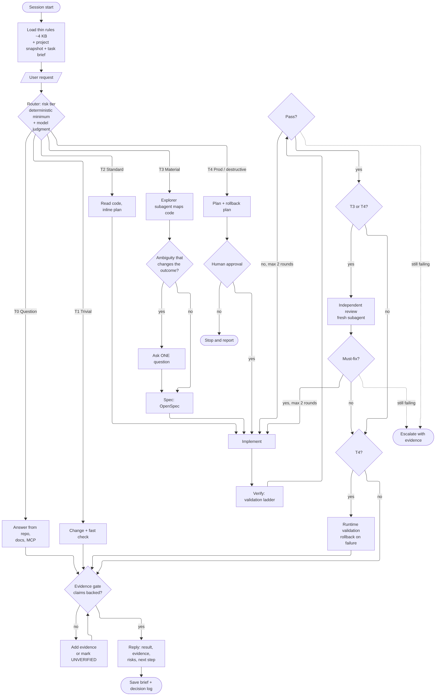
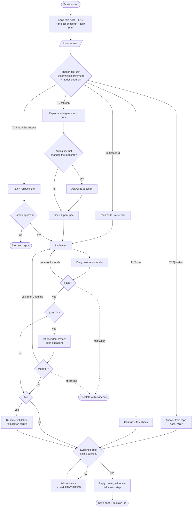

# Ideal harness (draft for discussion)

Draft proposal, 2026-11-08. It is the starting point for the one-by-one review in `TRACKER.md`, not a decision.
Each box is revisited when its component (C1–C26) is discussed.

## Design principles

1. **Thin always-on, rich on demand.** About 4 KB of rules loads every turn: principles plus the ask and stop
   triggers. Workflows, domain knowledge and templates load only when the task needs them (skills, playbooks).
2. **Rigour scales with risk.** A router assigns a tier. Deterministic patterns set the minimum (for example,
   `terraform apply`, `kubectl delete` or a push to main is at least T4); the model may raise a tier, never lower it.
3. **Deterministic over advisory.** Anything that must always happen is a permission rule, sandbox setting or hook,
   not rule text.
4. **One bounded loop.** Implement → verify → (review for T3/T4) → fix, at most 2 rounds, then escalate with
   evidence instead of guessing.
5. **Ask rarely, ask once.** Only for ambiguity that changes the outcome, and for T4 approval.
6. **No claim without evidence.** A Stop-time evidence gate checks that "done", "fixed" or "tested" is backed by a
   command result, file:line or source, or marked UNVERIFIED.
7. **Prove it.** The harness is benchmarked against plain Claude Code; changes ship only after a human approves
   them and the benchmark is re-run.

## Tiers

| Tier | Example | Path |
|---|---|---|
| T0 Question | "How does SQS visibility timeout work?" | Answer with sources |
| T1 Trivial | Typo, one config value | Change + fast check |
| T2 Standard | Small feature or fix in one area | Read code, inline plan, loop |
| T3 Material | New module, cross-cutting change, design decision | Explorer subagent, one question if needed, OpenSpec, loop with independent review |
| T4 Production / destructive | Apply, delete, migrate, IAM, prod deploy | Plan + rollback, human approval, loop with review, runtime validation |

## Always on (not drawn in the flow)

| Part | Mechanism | Components |
|---|---|---|
| Permissions, sandbox, deny rules | Claude Code settings | C8, C19 |
| Guard hooks: protected push, secrets, destructive commands | PreToolUse hooks | C7, C19 |
| Telemetry: tokens, time, outcome per task | Stop / PostToolUse hook or OpenTelemetry | C20 |
| Brief and decision log saved at compaction and stop | PreCompact / Stop hooks | C15 |

## Offline improvement loop

Benchmark (plain vs harness) → find failures → propose a rule or hook change → human approves → ship → re-run the
benchmark. (C21, C26)

## Mermaid source

